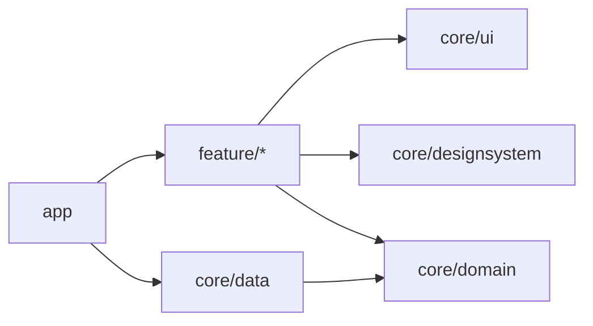

<div align="center">

# PetJá

**Delivery de produtos para pets em Boa Vista (RR)**

Uma vitrine com os petshops da cidade: o cliente informa onde está, vê as lojas que entregam ali,
monta o carrinho e recebe em casa.

[](https://github.com/gabrielevanger/petja-android/actions/workflows/ci.yml)
[](https://github.com/gabrielevanger/petja-android/actions/workflows/keep-alive.yml)
[](https://github.com/gabrielevanger/petja-android/commits/main)
[](https://github.com/gabrielevanger/petja-android/issues)

<br>

**Plataforma e linguagem**

[](https://developer.android.com)
[](https://kotlinlang.org)
[](https://gradle.org)
[](https://developer.android.com/build)

**Interface e arquitetura**

[](https://developer.android.com/compose)
[](https://m3.material.io)
[](https://dagger.dev/hilt)
[](https://developer.android.com/guide/navigation)
[](https://kotlinlang.org/docs/coroutines-overview.html)
[](https://github.com/Kotlin/kotlinx.serialization)

**Back-end**

[](https://supabase.com)
[](https://www.postgresql.org)
[](https://ktor.io)
[](https://supabase.com/docs/guides/realtime)

**Testes e qualidade**

[](https://junit.org)
[](https://robolectric.org)
[](https://github.com/cashapp/turbine)
[](https://github.com/takahirom/roborazzi)
[](https://docs.konsist.lemonappdev.com)
[](https://github.com/Kotlin/kotlinx-kover)
[](https://pinterest.github.io/ktlint)
[](https://developer.android.com/studio/write/lint)
[](https://www.conventionalcommits.org/pt-br)

</div>

---

## Telas

<p align="center">
  
  &nbsp;&nbsp;
  
</p>

<p align="center"><sub>Imagens geradas pelos screenshot tests (Roborazzi): se a tela mudar sem querer, o CI falha.</sub></p>

## Funcionalidades

| Para quem | O que já faz |
|---|---|
| **Cliente** | Vitrine por bairro com as lojas que entregam ali, página da loja com categorias e produtos, carrinho com taxa de entrega e pedido mínimo, checkout com pagamento na entrega e acompanhamento do pedido ao vivo |
| **Conta** | Entrar, criar conta, recuperar e trocar senha |
| **Lojista** | Modo loja com os pedidos chegando ao vivo, alerta sonoro e avanço das etapas do pedido |

Projeto pessoal, por enquanto com dados fictícios. O plano completo está em [REQUISITOS.md](REQUISITOS.md)
e o que falta fazer está nas [issues por fase](https://github.com/gabrielevanger/petja-android/milestones).

## Arquitetura

Modularização por camada e por funcionalidade, como recomenda o
[guia de modularização do Android](https://developer.android.com/topic/modularization):

```
app .................. MainActivity, navegação e configuração do Supabase
feature/storefront ... vitrine: lojas que entregam no endereço (ou petshops não parceiros)
feature/store ........ página da loja, com categorias e produtos
feature/cart ......... carrinho, taxa de entrega e pedido mínimo
feature/checkout ..... endereço, pagamento na entrega e pedido enviado
feature/orders ....... meus pedidos e acompanhamento ao vivo
feature/account ...... entrar, criar conta, senha e conta
feature/storemode .... modo lojista: pedidos da loja ao vivo, etapas e alerta sonoro
core/ui .............. formatação (R$, distância), links de contato e coleta de eventos
core/designsystem .... tema do PetJá (paleta do lavrado), claro e escuro, e componentes
core/data ............ Supabase (PostgREST, Auth e Realtime via supabase-kt), DTOs e mapeamento
core/domain .......... Kotlin puro: modelos e regras de negócio
build-logic .......... plugins de convenção do Gradle
supabase ............. migrações, seed, RLS e testes do banco
```



`core/domain` não depende de nada do Android (um teste do Konsist garante isso).

Cada tela segue **fluxo unidirecional de dados (UDF)**: a tela envia `Action` para o `ViewModel`, que publica
um `UiState` imutável e eventos únicos (`Event`, como navegação e snackbar). A `Route` liga o ViewModel e a
`Screen` só desenha. Os detalhes estão em [CONTRIBUTING.md](CONTRIBUTING.md#telas-e-viewmodels).

## Rodar o app

1. Crie o projeto no Supabase e aplique o banco (passo a passo em [supabase/README.md](supabase/README.md)).
2. Em *Project Settings → API*, copie a **Project URL** e a chave **anon public**.
3. Coloque no `local.properties` da raiz (o arquivo não vai para o Git):

```properties
sdk.dir=/caminho/do/Android/Sdk
supabase.url=https://SEU-PROJETO.supabase.co
supabase.anonKey=SUA_CHAVE_ANON
```

4. Abra no Android Studio e rode o `app`, ou:

```bash
./gradlew :app:installDebug
```

Sem `supabase.url`, o app compila e abre, mas a vitrine mostra o erro de conexão.

A chave **anon** é pública por natureza: quem protege os dados é a RLS do banco. Nunca coloque a
chave `service_role` no app.

## Qualidade

Tudo abaixo roda no CI em cada pull request, e a `main` só aceita merge com os três checks verdes.

| Verificação | Ferramenta | O que garante |
|---|---|---|
| Testes de ViewModel e domínio | JUnit, Turbine, coroutines-test | Cada ação muda o estado do jeito certo |
| Testes de tela | Robolectric e Compose Test | As telas funcionam na JVM, sem emulador |
| Screenshot tests | Roborazzi | Nenhuma tela muda de aparência sem querer |
| Testes de arquitetura | Konsist | Domínio sem Android, ViewModels com Hilt, UiState imutável, Screen sem ViewModel |
| Cobertura | Kover | Mínimo de 80% por módulo e 90% no projeto |
| Estilo e análise estática | ktlint e Android Lint | Código padronizado e sem problemas conhecidos do Android |
| Design tokens | `scripts/check-ui-tokens.sh` | Nenhuma cor, medida ou texto solto fora do tema |
| Banco | Node (`supabase/tests`) | Migrações, seed e regras de RLS |
| Commits | hook e CI | Conventional Commits em português |

Para rodar localmente:

```bash
./gradlew ktlintCheck :app:lintDebug test
```

```bash
./gradlew koverHtmlReportCoverage koverVerifyCoverage
```

```bash
./scripts/record-screenshots.sh
```

```bash
cd supabase/tests && npm install && npm test
```

O relatório de cobertura fica em `build/reports/kover/htmlCoverage/index.html`. Depois de mudar uma tela de
propósito, o `record-screenshots.sh` regrava as imagens de referência: confira e commite junto.

## Contribuir

Conventional Commits em português, validados por hook e no CI. Fluxo de branch, PR e padrões de código em
[CONTRIBUTING.md](CONTRIBUTING.md). O banco tem documentação própria em [supabase/README.md](supabase/README.md).
